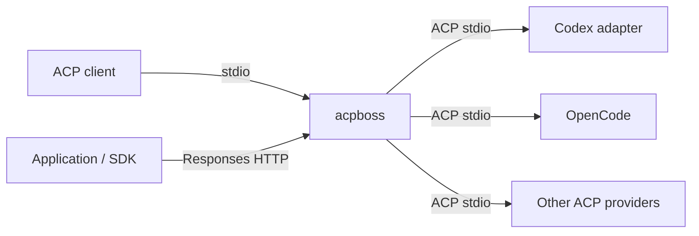

# acpboss

**One entry point for your ACP agents.**

Run Codex, OpenCode and other Agent Client Protocol providers behind a single
command. Connect an ACP client or use the OpenAI Responses HTTP interface, then
select a model with a `provider/model` identifier.

[](https://github.com/baldaworks/acpboss/actions/workflows/test.yml)
[](https://github.com/baldaworks/acpboss/actions/workflows/lint.yml)
[](LICENSE)

[Get started](docs/getting-started.md) · [Documentation](docs/README.md) ·
[Configuration](docs/configuration.md) · [OpenAPI](docs/openapi.yaml)

## Why acpboss?

- **Connect your tools once.** Choose ACP stdio for agent clients or Responses
  HTTP for applications and SDKs.
- **Route by model.** `codex/gpt-6.1-sol` selects Codex;
  `opencode/opencode/MODEL_ID` selects an OpenCode model. Actual IDs come from
  the provider catalog.
- **Keep provider-native behavior.** Providers own their authentication, model
  access and tools. ACP sessions retain separate histories for each provider.
- **Send more than text.** ACP forwards images, audio and resources when supported.
  HTTP accepts inline images and files and returns text.
- **Use a defined API contract.** The Responses subset is described in OpenAPI;
  its Go transport and wire types are generated and checked in CI.



## Quick start

You need Go **1.26.10+**, an ACP provider executable, and that provider's own
authentication. Build from a checkout:

```sh
go build -trimpath -o bin/acpboss ./cmd/acpboss
```

Create `config.yaml` with the providers you have installed and authenticated:

```yaml
runtime:
  providers:
    opencode:
      cmd: "opencode acp"
acpboss:
  working_dir: .
```

Start the HTTP interface:

```sh
./bin/acpboss api --config config.yaml
```

In another terminal, discover models and send a request with an actual ID:

```sh
curl -sS http://127.0.0.1:8080/v1/models
curl -sS http://127.0.0.1:8080/v1/responses \
  -H 'Content-Type: application/json' \
  -d '{"model":"opencode/UPSTREAM_MODEL_ID","input":"Hello","store":false}'
```

Read `status` in the response: `completed`, `incomplete` or `failed`. HTTP 200
alone does not guarantee successful generation. For an ACP client, configure it
to launch the same binary with `stdio --config /absolute/path/to/config.yaml`.
See the [full walkthrough](docs/getting-started.md) for Codex, streaming and
connection examples.

## Choose your interface

| | ACP stdio | Responses HTTP |
| --- | --- | --- |
| Start command | `acpboss stdio` | `acpboss api` |
| Conversation state | Separate native history per provider within a live logical session | Reuse native sessions with `conversation`; omit it for a one-shot request |
| Input | Text, image, audio and resources, subject to provider capabilities | Text, inline images and inline files |
| Output | ACP content and tool updates | Text JSON or Responses SSE |
| Interactive permissions | Forwarded to the ACP client | Cancelled; response fails |

Create a [live HTTP conversation](docs/usage.md#continue-a-conversation) to send
only new input on each turn. acpboss keeps its session IDs in memory; providers
own the history. Handles last until deletion or process shutdown.

The HTTP interface implements **`/v1/responses`** and conversation lifecycle routes.
`/v1/chat/completions` and `/v1/completions` return 404. Stored responses, remote
media fetching, uploaded file IDs and HTTP audio are outside this subset.
The HTTP listener defaults to localhost and has no built-in authentication or
TLS. See [usage and boundaries](docs/usage.md) before integrating it.

## Documentation

- [Get started](docs/getting-started.md) — build, configure and make your first request.
- [Configuration](docs/configuration.md) — providers, profiles, flags and environment.
- [Use ACP and HTTP](docs/usage.md) — streaming, history, SDKs and permissions.
- [Multimodal content](docs/multimodality.md) — image/file examples and supported formats.
- [Troubleshooting](docs/troubleshooting.md) — startup, models, failures and diagnostics.
- [Protocol mapping](docs/protocol-mapping.md) — exactly what maps to ACP and back.
- [Development](docs/development.md) — code generation, checks and real-provider smoke tests.

## Contributing

Issues and pull requests are welcome. Start with [CONTRIBUTING.md](CONTRIBUTING.md)
and run `task check` before submitting a change. Build and development commands
are listed in the [developer guide](docs/development.md).

## License and author

[MIT](LICENSE) · Copyright © 2026 **Alexey Samoylov**.
