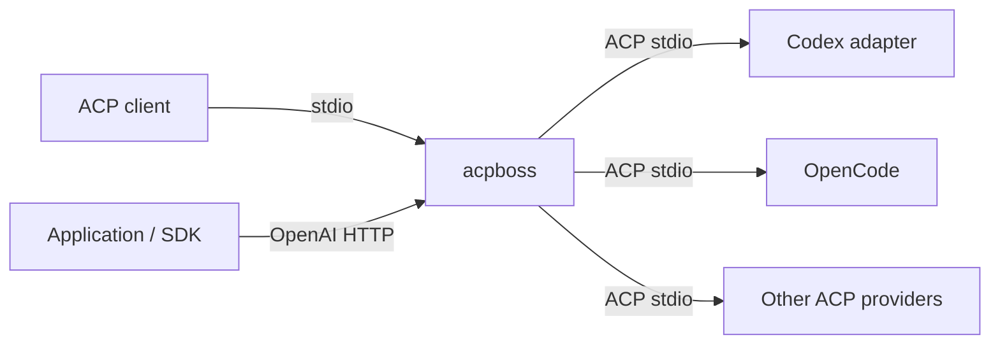

# acpboss

**One entry point for your ACP agents.**

Run Codex, OpenCode and other Agent Client Protocol providers behind a single
command. Connect an ACP client or use the OpenAI-compatible HTTP interface, then
select a model with a `provider/model` identifier.

[](https://github.com/baldaworks/acpboss/actions/workflows/test.yml)
[](https://github.com/baldaworks/acpboss/actions/workflows/lint.yml)
[](LICENSE)

[Get started](docs/getting-started.md) · [Documentation](docs/README.md) ·
[Configuration](docs/configuration.md) · [OpenAPI](docs/openapi.yaml)

## Why acpboss?

- **Connect your tools once.** Choose ACP stdio for agent clients or Responses
  and Chat Completions HTTP for applications and SDKs.
- **Route by model.** `codex/gpt-6.1-sol` selects Codex;
  `opencode/opencode/MODEL_ID` selects an OpenCode model. Actual IDs come from
  the provider catalog.
- **Keep provider-native behavior.** Providers own their authentication, model
  access and tools. ACP sessions retain separate histories for each provider.
- **Send more than text.** ACP forwards images, audio and resources when supported.
  HTTP accepts inline images and files and returns text.
- **Use a defined API contract.** The OpenAI HTTP subset is described in OpenAPI;
  its Go transport and wire types are generated and checked in CI.



## Quick start

You need Go **1.26.10+**, an ACP provider executable, and that provider's own
authentication. Build from a checkout:

```sh
go build -trimpath -o bin/acpboss ./cmd/acpboss
```

Create `config.yaml` with the providers you have installed and authenticated:

```yaml
runtime:
  providers:
    opencode:
      cmd: "opencode acp"
acpboss:
  working_dir: .
```

Start the HTTP interface:

```sh
./bin/acpboss api --config config.yaml
```

The HTTP listener becomes ready independently of provider health. Each provider
is supervised and retried in the background; an unavailable provider is absent
from the model catalog until it recovers.

In another terminal, discover models and send a request with an actual ID:

```sh
curl -sS http://127.0.0.1:8080/v1/models
curl -sS http://127.0.0.1:8080/v1/responses \
  -H 'Content-Type: application/json' \
  -d '{"model":"opencode/UPSTREAM_MODEL_ID","input":"Hello","store":false}'
curl -sS http://127.0.0.1:8080/v1/chat/completions \
  -H 'Content-Type: application/json' \
  -d '{"model":"opencode/UPSTREAM_MODEL_ID","messages":[{"role":"user","content":"Hello"}]}'
```

Read `status` in the response: `completed`, `incomplete` or `failed`. HTTP 200
alone does not guarantee successful generation. For an ACP client, configure it
to launch the same binary with `stdio --config /absolute/path/to/config.yaml`.
See the [full walkthrough](docs/getting-started.md) for Codex, streaming and
connection examples.

To keep provider-native context across requests, create a process-local
conversation handle and send only the new input on each turn:

```sh
base=http://127.0.0.1:8080/v1
conversation_id=$(curl -fsS "$base/conversations" \
  -H 'Content-Type: application/json' \
  -d '{"metadata":{"client":"readme"}}' | jq -r .id)
curl -sS "$base/responses" \
  -H 'Content-Type: application/json' \
  -d "{\"model\":\"opencode/UPSTREAM_MODEL_ID\",\"conversation\":\"$conversation_id\",\"input\":\"Remember violet.\"}"
curl -sS "$base/responses" \
  -H 'Content-Type: application/json' \
  -d "{\"model\":\"opencode/UPSTREAM_MODEL_ID\",\"conversation\":{\"id\":\"$conversation_id\"},\"input\":\"What word?\"}"
curl -sS -X DELETE "$base/conversations/$conversation_id"
```

The string and `{"id":"conv_…"}` conversation selectors are equivalent. An
attached Response includes `conversation:{"id":"conv_…"}` and always reports
`store:false`.

## Choose your interface

| | ACP stdio | OpenAI HTTP |
| --- | --- | --- |
| Start command | `acpboss stdio` | `acpboss api` |
| Conversation state | Separate native history per provider within a live logical session | Responses can reuse native sessions with `conversation`; Chat requests are one-shot |
| Input | Text, image, audio and resources, subject to provider capabilities | Text and inline images; Responses also accepts inline files |
| Output | ACP content and tool updates | Text JSON or API-specific SSE |
| Interactive permissions | Forwarded to the ACP client | Cancelled; response fails |

The supported HTTP API is:

| Route | Purpose |
| --- | --- |
| `GET /v1/models` | Discover currently available qualified model IDs. |
| `POST /v1/responses` | Generate once or continue a live conversation. |
| `POST /v1/chat/completions` | Generate from OpenAI-style messages, with optional streaming. |
| `POST /v1/conversations` | Create a handle with optional string metadata. |
| `GET /v1/conversations/{id}` | Read handle identity, creation time and metadata. |
| `POST /v1/conversations/{id}` | Replace metadata; `metadata:null` clears it. |
| `DELETE /v1/conversations/{id}` | Delete the handle and release native sessions. |

Conversation handles retain only routing metadata in acpboss; providers own
the history. Handles last until deletion or process shutdown and are not
recovered after restart. There are no conversation item/history endpoints or
stored response branches, and `previous_response_id` must be omitted or null.

Legacy `/v1/completions` returns 404. Chat Completions is a strict, stateless
subset: clients resend message history, `n` is omitted or `1`, `store` is omitted
or `false`, and tools, sampling controls and structured output are rejected.
Stored responses, remote media fetching, uploaded file IDs and HTTP audio are
outside this subset.
The HTTP listener defaults to localhost and has no built-in authentication or
TLS. See [conversation details](docs/usage.md#continue-a-conversation),
[usage and boundaries](docs/usage.md), and the [OpenAPI contract](docs/openapi.yaml)
before integrating it.

## Documentation

- [Get started](docs/getting-started.md) — build, configure and make your first request.
- [Configuration](docs/configuration.md) — providers, profiles, flags and environment.
- [Use ACP and HTTP](docs/usage.md) — streaming, history, SDKs and permissions.
- [Multimodal content](docs/multimodality.md) — image/file examples and supported formats.
- [Troubleshooting](docs/troubleshooting.md) — startup, models, failures and diagnostics.
- [Protocol mapping](docs/protocol-mapping.md) — exactly what maps to ACP and back.
- [Development](docs/development.md) — code generation, checks and real-provider smoke tests.

## Contributing

Issues and pull requests are welcome. Start with [CONTRIBUTING.md](CONTRIBUTING.md)
and run `task check` before submitting a change. Build and development commands
are listed in the [developer guide](docs/development.md).

## License and author

[MIT](LICENSE) · Copyright © 2026 **Alexey Samoylov**.
